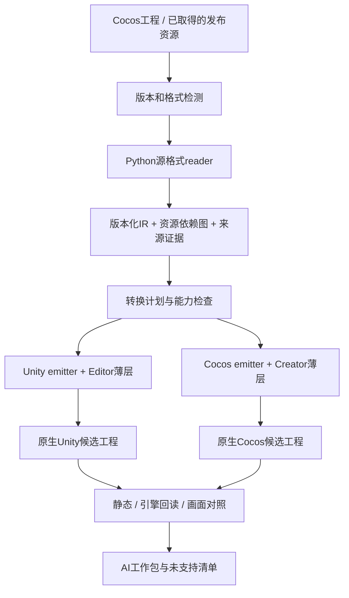

# monkey 架构与数据合同

## 当前产品范围

包级wxapkg/APK/明确Cocos资源集合 → 安全解包与身份 → 全文件台账 → 资源/静态代码模块恢复 → Unity6/Creator3.8标准工程＋代码初稿 → AI接续。每项输入有处置、来源hash与目标路径；未支持原件/代码在SourceRecovery编译排除区，不当原生资产。目标运行时不解释IR或源引擎对象图。完整源码初稿允许未实现业务，不假成功；源证据、draft、compiled、behavior_verified分列。

Unity资源遵循Assets/Game/Content类型、五层模块与Game/Editor；Creator遵循assets/scripts五层、art/audio/fonts/scenes/prefabs。已有切片生成目录暂作为历史适配例外，新包级产物采用规范布局。每个工程有AGENTS、Docs/START-HERE、资源覆盖和模块工作包，可独立搬走；不依赖本机原源路径。

## 设计原则

1. 一次解析、按目标输出；源引擎语义与目标实现分离。
2. Python是主体；编辑器胶水仅完成原生导入、保存与回读。
3. 明确版本/格式子集、未知即显式缺口；不执行源游戏代码，不模拟源引擎运行时。
4. 默认新候选输出；原件不可变，人工编辑不被再次生成覆盖。
5. 中间数据用于转换，不进入Player解释执行。正式数值保持JSON，原生资产管理对象引用。



## 建议目录

```text
monkey/
  pyproject.toml
  src/monkey/
    cli.py                   # 唯一CLI入口
    contracts/               # IR、报告、目标profile和升级
    sources/cocos24/          # 源工程与发布资源reader分开
    sources/cocos38/          # 后续显式支持，不猜格式
    assets/                  # 图集、SpriteFrame、字体、音频、Spine描述
    graph/                   # ID、引用闭包、变更与未支持项
    targets/unity/           # 目标映射与导入计划
    targets/cocos38/         # 目标meta/资源/节点映射
    safety/                  # 路径、预算、候选、hash、冲突
    reports/                 # 汇总、预览索引、AI交接
  adapters/unity/Editor/      # 小型C#导入/保存/回读
  adapters/cocos/             # Creator原生导入与保存薄扩展
  schemas/                   # 由合同维护的JSON Schema
  tests/fixtures/             # 自造最小样本，无原游戏私有内容
  docs/
  .private/                  # 私有真实样本与源映射，不进Git
  outputs/                   # 候选及验证产物，不进Git
```

不是每个目录第一天都建空框架；按首个完整切片实现需要的模块。避免统一框架先行而没有可见产物。

## 数据合同

### source-manifest

记录sourceId、sourceEngine/sourceVersion、serializationProfile、包/bundle身份、逻辑路径、字节hash、引用、实际读取范围与缺失文件。恢复的是已取得文件，不宣称缓存等于全游戏内容。ID采用来源命名空间+稳定原UUID/对象定位，不仅用展示名称，也不将内容hash当唯一逻辑身份。

### IR（版本化JSON，中间描述）

- `schemaVersion`、源manifest摘要、sourceProfile、解析器版本。
- `assets`：kind、sourceId、sourcePath、hash、原生依赖、目标候选路径。
- `spriteFrames`：textureRef、rect、rotated、trimmed/originalSize、offset、pivot/anchor依据、capInsets、颜色空间/预乘信息（未知不得猜为已知）。
- `nodes`：sourceId、parent/children、localTransform、size、anchor、active、opacity/color、绘制顺序与组件引用。坐标单位、旋转单位、原点与父级变换语义必须显式。
- `components`：已支持类型及类型化字段，resource/object references；未知组件留type/raw-location/affected-scope，不吞掉。
- `animations`：有限已知轨道、时间单位、曲线与事件，未知easing保留待处理；不复制Cocos引擎实现。
- `bindings`：已发现脚本类型、属性引用、事件目标与源码定位，仅给AI接续，不当作已恢复函数。
- `diagnostics`：severity、code、sourceId、sourceLocation、影响模块、建议动作及证据引用。

禁止将整个源对象图作为一个不透明JSON字段让目标运行时解释。raw片段只在Analysis报告用于溯源；目标生成器消费明确定义的类型化语义。

### target-profile

目标引擎精确版本、导入adapter版本、渲染/UI方案、设计尺寸/PPU、支持组件矩阵、Spine/runtime版本及依赖来源。默认值只是显式预设；源数据和用户批准值优先。Unity6000.6.2f1、Creator3.8.8先分别记录实测状态，其他版本unknown，不自动安装/升级。

### conversion-plan与输出manifest

把每项标为`convertible / needs_adapter / missing_asset / unsupported / conflict`；区分阻断当前切片和仅影响其他模块的诊断。可生成诊断预览，但缺脚本/占位不能标为生产可用。

每个输出文件记录目标相对路径、hash、对应source IDs、生成器版本、owner（generated/manual）、dependencies。映射文件存Analysis，不把SourceIdentity组件挂入生产Prefab。

目标GUID/UUID按稳定项目命名空间和source ID确定并维护映射；目标子资源fileID以导入器真实回读为准，不能用字符串拼接猜测。相同输入重复生成语义稳定，source/target变更有清晰diff。

## 组件映射策略

| 源语义 | Unity | Cocos3.8 |
|---|---|---|
| 2D Node变换/尺寸/锚点 | 原生GameObject＋RectTransform | Node＋UITransform |
| SpriteFrame/九宫格 | Sprite/TextureImporter＋Image或SpriteRenderer | Texture/SpriteFrame及Sprite |
| Label | 经批准匹配的TMP/uGUI方案，字体/字库语义单列 | Label/Font；位图字体有独立路径 |
| Opacity/Color | Image/TMP颜色或适用CanvasGroup | UIOpacity及组件颜色 |
| Button/事件 | Button＋序列化View引用，业务方法待AI | Button＋原生组件引用，业务方法待AI |
| Mask/Scroll/List | 原生Mask/RectMask2D/ScrollRect，动态复用另处理 | 对应原生组件，版本参数明确 |
| Spine | 与数据版本匹配的spine-unity引用 | 与Creator/runtime匹配的SkeletonData |
| 自定义脚本 | 源模块恢复＋C#结构/有限语义初稿，不生成假业务成功 | 源模块恢复＋TS声明/引用初稿，未知行为明确待恢复 |

物理、复杂材质/Shader、富文本、动态Layout、滤镜、粒子、skew及未知序列化编码不在首版默认自动转换范围。按具体切片缺口增加支持，不能强行“近似成功”。

## 输出安全与可维护性

- 路径规范化、防穿越/输出输入重叠、符号链接边界、大小/节点数/深度/像素预算；外部解码器受控且不执行原包内程序。
- 原文件hash在读取前后校验；文件变化则该切片重新读取，保留原结果为过期，不混入当前产物。
- 首次输出到新候选目录。再次生成先比上次manifest与实际目标，发现人工修改即conflict；apply只覆盖仍匹配的generated路径，manual区域永不覆盖。删除输出列待处理，不隐式rm。
- 正常目标工程去掉转换器和IR仍能打开/修改/运行已生成部分；生成器可作为离线制作工具保留，但Build不自动重跑源资源转换。
- 日常业务实现由AI维护目标原生代码，工具不把手工成果反向回写源包。源数据更新后做显式候选差异合并，不自动双向同步。

## 与GREA的关系

monkey为独立Python产品，GREA保持现有维护边界。先只读比较其`cocos_assets`、`cocos_modules`、`cocos_convert`、`unity_native_assets`和资产台账合同；算法复用需核对许可证/来源并移除本机路径，不能直接import另一个仓库或复制其私有素材。

首版以稳定CLI/JSON合同交付。后续GREA可调用monkey的能力发现、inspect/export/handoff；是否增加GREA provider/MCP由另行维护任务决定。本轮不双写GREA工具实现。

## 已批准来源家族扩展

Unity来源专用typed序列化对象/PPtr/GUID/fileID与固定提取provider；Cocos2/3分别解析真实版本的序列化，共享有据语义而非强制同一原图。来源和目标路由分开，Unity→Unity6，Cocos→Cocos3.8/Unity6/both，Unity→Cocos拒绝。原名与身份、资源账、代码可信度、阶段签名和Editor原生回读为共同合同。当前实现/计划边界见SUPPORT-MATRIX.md，顺序与出口见ENGINE-ROADMAP.md；不是增加文档就宣布已支持。
